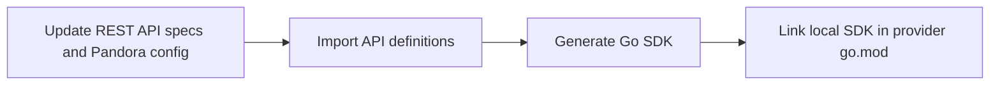
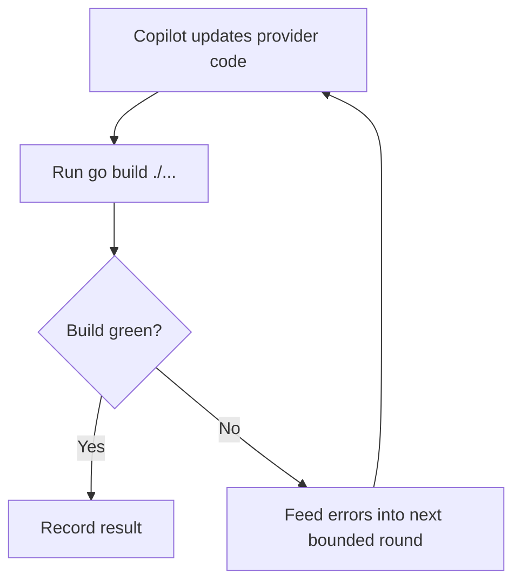
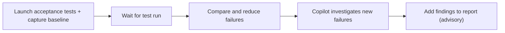
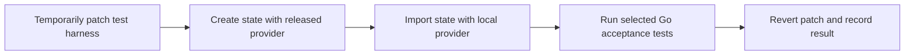

# apiupgrader

A GitHub Copilot-powered CLI for upgrading one Azure Resource Provider SDK API
version in `terraform-provider-azurerm` (AzureRM API Upgrader).

It edits the supplied checkout, resolves compile failures, assesses user-facing
API changes as breaking or non-breaking, and can investigate acceptance-test
failures. Acceptance tests are advisory; upgrade success is determined by
`go build ./...`.

All changes are made directly in the supplied checkout on its currently checked-out
branch and remain unstaged for review. The tool never creates or switches branches,
commits, pushes, or opens pull requests.

## Prerequisites

Run the documented workflow from a **Windows PowerShell terminal** (Windows
PowerShell or PowerShell 7). The commands and orchestration are written for
PowerShell; Bash, Command Prompt, and WSL are not supported or tested.

- Python 3.9 or newer, Git for Windows, and the Go toolchain required by the
  provider checkout. Make sure `python`, `git`, and `go` are available in the
  PowerShell `PATH`.
- Network access to the required Git remotes, GitHub Copilot, Go module
  sources, and Terraform Registry when running `breaking-change`; acceptance
  tests also need access to Azure and, when configured, the TeamCity server.
- A writable local `terraform-provider-azurerm` checkout. Configure Git
  authentication independently (for example, Git Credential Manager or SSH)
  for any private remotes. The upgrader does not pull or switch branches for
  you.
- A `GH_TOKEN` with GitHub Copilot access for the `upgrade` and `acctest`
  stages. The standalone `prebuild` and `breaking-change` stages do not use a
  Copilot agent.
- For API spec context and operation changes: install `gh` on `PATH` and
  authenticate with `gh auth login` or `GH_TOKEN` / `GITHUB_TOKEN`. Requires
  GitHub API access and matching specs in `Azure/azure-rest-api-specs`.
  Version comparisons also need an old API version (auto-detected or set via
  `--old-api-version`) and its specs. Collection failures do not stop the stages.
- For `acctest` and `breaking-change`: Terraform on `PATH` and the Azure
  service-principal settings listed below.
- For `prebuild`: `goimports` on `PATH` and writable local Pandora and
  `go-azure-sdk` checkouts.

The default pipeline runs `upgrade` and `acctest`, so it needs the prerequisites
for both stages. Select explicit stages with `--stage` to avoid requiring
prerequisites for stages you are not running.

## Install

```powershell
git clone "https://github.com/QixiaLu/azurerm-rp-sdk-upgrader.git" "apiupgrader"
Set-Location ".\apiupgrader"
python -m venv .venv
.\.venv\Scripts\python.exe -m pip install -e .
```

Create a local `.env` file in the upgrader repository (it is git-ignored) for
the credentials required by the stages you plan to run. For example:

```dotenv
GH_TOKEN=<token-with-github-copilot-access>

# Required for acctest and breaking-change
ARM_CLIENT_ID=<service-principal-client-id>
ARM_CLIENT_SECRET=<service-principal-client-secret>
ARM_SUBSCRIPTION_ID=<subscription-id>
ARM_TENANT_ID=<tenant-id>
ARM_TEST_LOCATION=eastus
ARM_TEST_LOCATION_ALT=westus2
ARM_TEST_LOCATION_ALT2=centralus

# Optional for comparing acceptance failures with the TeamCity baseline
TEAMCITY_TOKEN=<teamcity-access-token>
# Optional; defaults to https://hashicorp.teamcity.com
# TEAMCITY_SERVER_URL=https://teamcity.example.com
```

`TEAMCITY_ACCESSTOKEN` is also accepted in place of `TEAMCITY_TOKEN`. Without
either TeamCity token, acceptance testing can still run, but its baseline
comparison is degraded. `GH_TOKEN` is needed only for stages that use Copilot.
Shell environment variables take precedence over `.env`; `--env-file` selects
an alternative credentials file.

Run `.\.venv\Scripts\apiupgrader.exe` from the project directory; virtual
environment activation is not required.

### Updating the provider checkout

Before running an upgrade, update the local provider checkout from PowerShell
if needed. Git must have network access and credentials for the remote:

```powershell
git -C "C:\Repos\terraform-provider-azurerm" status --short
git -C "C:\Repos\terraform-provider-azurerm" pull --ff-only
```

Review or save local changes before pulling. The upgrader works against the
checkout as it exists and does not run `git pull`, change branches, commit, or
push. The `breaking-change` stage also needs these files in the provider
checkout to be clean: `internal/acceptance/testcase.go` and
`internal/acceptance/breaking_change_test.go`.

## Usage

Run all stages: generate the local SDK, upgrade the provider, investigate
acceptance-test failures, and detect breaking changes.

```powershell
.\.venv\Scripts\apiupgrader.exe keyvault 2023-07-01 `
  --repo "C:\Repos\terraform-provider-azurerm" `
  --stage prebuild `
  --stage upgrade `
  --stage acctest `
  --stage breaking-change `
  --pandora-repo "C:\Repos\pandora" `
  --go-azure-sdk-repo "C:\Repos\go-azure-sdk" `
  --pandora-service KeyVault `
  --old-api-version 2023-02-01 `
  --provider-version 4.77.0 `
  --test-regex 'TestAccKeyVault_'
```

Replace the example paths and versions with your local values.
`--pandora-service` must match Pandora's `name` in `config/resource-manager.hcl`.
`--provider-version` must match the released version represented by the
checked-out provider repository; find it in that repository's `CHANGELOG.md`.

Stages can also run independently; chaining all four is optional. Keep only the
`--stage` options you want to run, or use a single `--stage` to run one stage.
When omitting `prebuild`, also omit `--pandora-repo`, `--go-azure-sdk-repo`, and
`--pandora-service`; when omitting `breaking-change`, also omit
`--provider-version`. Without any `--stage` options, the default is `upgrade`
followed by `acctest`. Each selected stage still needs its prerequisites below;
for example, `upgrade` needs an available SDK, either published or generated by
an earlier `prebuild` run.

The detector runs `git` and `go test` directly; it does not require Bash or a
separate shell. `breaking-change.json` sets `breaking_change_detected` to `true`
when `breaking-change.log` contains `ImportStateVerify attributes not equivalent`.
Other test or setup failures still fail the stage but do not by themselves count
as a detected breaking change.

### Stage-specific requirements

| Stage | Additional requirements and settings |
| --- | --- |
| `prebuild` | Git, Go, and `goimports` on `PATH`; writable Pandora, `go-azure-sdk`, and provider checkouts. Supply `--pandora-repo`, `--go-azure-sdk-repo`, and `--pandora-service`. The service name is Pandora's `name` in `config/resource-manager.hcl`. |
| `upgrade` | `GH_TOKEN` with Copilot access, a writable provider checkout, and the provider's Go toolchain. The stage validates the change with `go build ./...`. If the SDK version is unpublished, run `prebuild` first. |
| `acctest` | Terraform and Go on `PATH`; Azure service-principal and test-location variables from `.env`; `GH_TOKEN` for Copilot-based failure analysis. A TeamCity token is optional but enables the baseline comparison. `--test-regex` and `--parallel` control test selection and concurrency. |
| `breaking-change` | Terraform, Go, Git, and the same Azure settings as `acctest`; set `--provider-version` to the version for the checked-out provider repo (find it in that repo's `CHANGELOG.md`), and optionally set `--test-regex` / `--parallel`. The stage temporarily patches acceptance-test harness files and restores them afterward. |

GitHub CLI (`gh`) is optional for running the stages, but required for the
additional Azure REST API spec context and operation changes described in
[Prerequisites](#prerequisites).

### How the stages work

Selected stages run in this order; stages not selected are skipped. `acctest`
is advisory, while a failed `prebuild`, `upgrade`, or `breaking-change` stops
the pipeline.

#### `prebuild`



#### `upgrade`



#### `acctest`



#### `breaking-change`

Sourced from https://github.com/ms-henglu/terraform-provider-sdk-diff-check-tool/tree/main



## Options

By default, the `upgrade` and `acctest` stages run. Supplying any `--stage`
replaces that default; repeat the option to select multiple stages. Stages always
run in pipeline order: `prebuild`, `upgrade`, `acctest`, then `breaking-change`.

| Option | Description |
| --- | --- |
| `--repo` | Provider checkout to edit (required). |
| `--stage` | Stage to run; repeat for multiple stages. |
| `--old-api-version` | Existing API version; detected when omitted. |
| `--test-regex` | Acceptance-test `-run` filter (default: `TestAcc`). |
| `--parallel` | Maximum parallel acceptance tests (default: 11). |
| `--provider-version` | AzureRM version for the checked-out provider repo, found in its `CHANGELOG.md`; required by the `breaking-change` stage. |
| `--max-rounds` | Maximum upgrade rounds (default: 8). |
| `--model` | Copilot model to use. |
| `--env-file` | Alternative credentials file. |
| `--debug` | Print agent tool-usage records. |
| `--pandora-repo` | Pandora checkout used for generation. |
| `--go-azure-sdk-repo` | `go-azure-sdk` checkout used for generation. |
| `--pandora-service` | Pandora service name used for generation. |

Run `.\.venv\Scripts\apiupgrader.exe --help` for the authoritative CLI reference.

## Output

The provider checkout contains the upgraded Go files and any generated dependency
changes. Each invocation gets a unique, retained run directory:

```text
<provider-repo>/.upgrader/<rp>/<target-version>/runs/<run-id>/
```

`latest.json` at `<provider-repo>/.upgrader/<rp>/<target-version>/` points to
the newest run. Every run has an orchestrator-owned `run.json` with the inputs,
stage statuses, timestamps, and paths to its stage artifacts. The main files are:

- `IMPLEMENTATION_PLAN.md`: completed work and remaining follow-ups.
- `result.json`: build result, API changes, breaking-change assessment, and
  acceptance-test findings when tests were run.
- `prebuild.json` and `prebuild.log`: local SDK generation status and logs, only
  when `--stage prebuild` was used.
- `breaking-change.json` and `breaking-change.log`: breaking-change test status and
  output, only when `--stage breaking-change` was used.
- `acctest/`: retained raw acceptance-test output, baseline, reduced analysis, and
  per-test failure logs when `--stage acctest` was used.

`result.json` is a versioned, machine-readable review report. `provenance`
records source/target API versions, commit, stages, and test scope;
`api_changes` distinguishes SDK model impact from the confirmed
`provider_surface`; `compatibility_checks` records supporting evidence.
`findings` and `actions` provide category, owner, blocking state, and next step.
Use `merge_readiness.verdict` (`ready`, `needs_review`, or `blocked`) as the
automation-friendly overall decision. Acceptance-test cleanup evidence and any
resource locators are recorded under `cleanup`.

Review changes with:

```powershell
git -C "C:\Repos\terraform-provider-azurerm" diff
```
